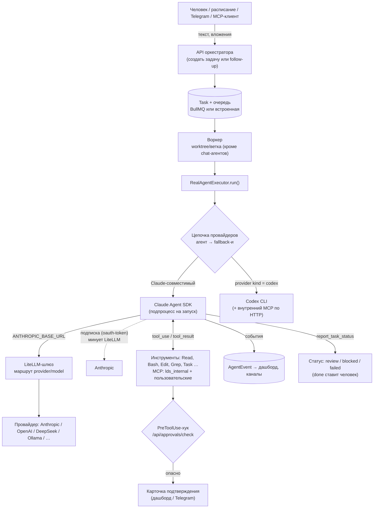
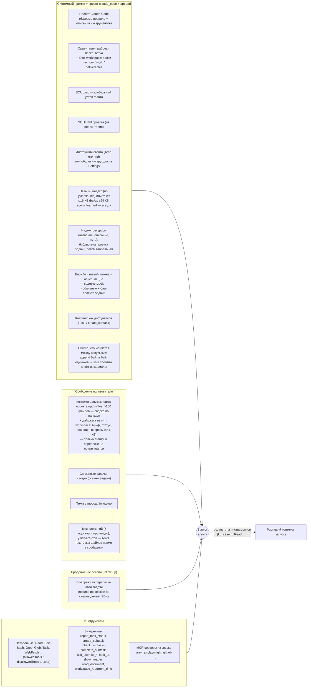
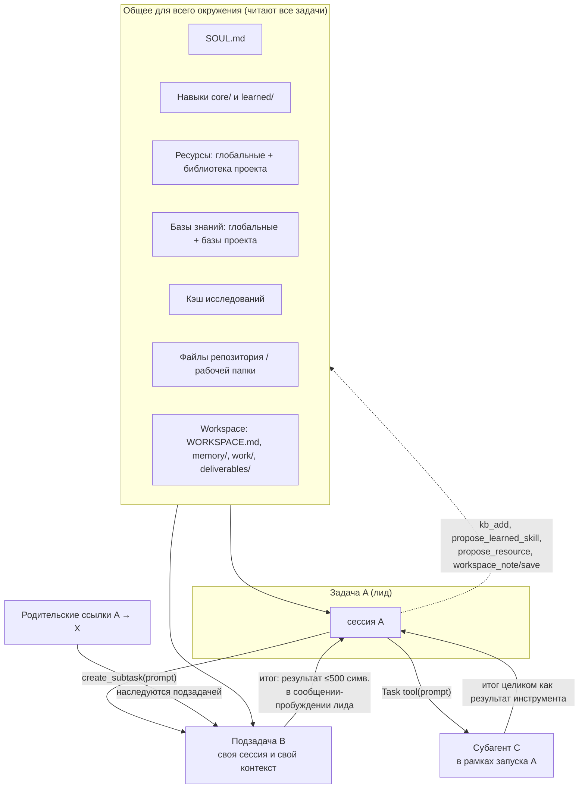
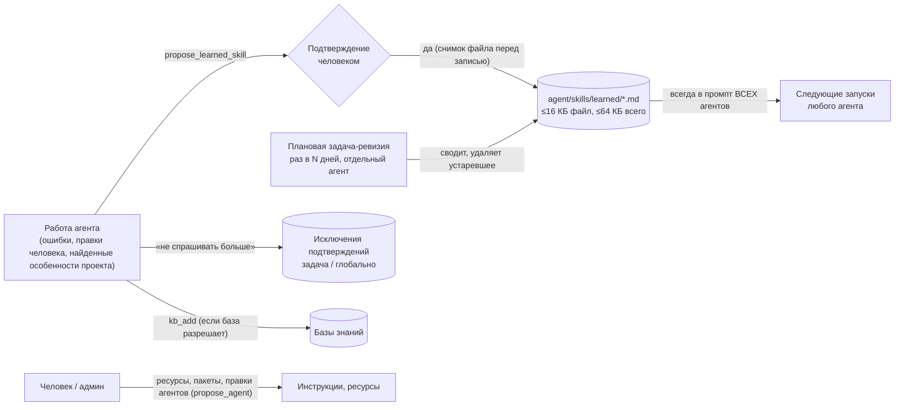

# Как строятся запросы к агентам и провайдерам, что попадает в контекст и как копится опыт

> Составлено по коду (2026-10-12, обновлено 2026-10-15 для v0.1.58): `apps/orchestrator/src/agent/real-agent-executor.ts`, `packages/agent-runner/src/run.ts`, `tasks/tasks.service.ts`,
> `agent-registry/skills-learned.service.ts`, `skill-consolidation-scheduler.service.ts`. Диаграммы — Mermaid (GitHub и IDE их рисуют);
> версия для браузера: `docs/request-flow.html`.

## Коротко — ответы на три вопроса

1. **Как строится запрос.** Сообщение человека (дашборд, Telegram, расписание, MCP) → задача → очередь → воркер → исполнитель собирает **системный
   промпт** (пресет Claude Code + наши слои) и **пользовательский промпт** → запускает агента (Claude Agent SDK или Codex CLI) → тот ходит к
   провайдеру через LiteLLM (или напрямую) → инструменты → результат. Все «опасные» вызовы проходят через шлюз подтверждений.
2. **Что в контексте.** В рамках одного запуска: системный промпт (ориентация в рабочей папке + блок общего workspace + SOUL + проектный SOUL + инструкции агента + навыки + индекс ресурсов (библиотека проекта задачи, затем глобальная) + блок баз
   знаний (глобальные + базы проекта задачи) + список коллег — всё это одинаково от запуска к запуску, чтобы кэш промпта провайдера переживал follow-up) и сообщение (карта проекта + дайджест памяти workspace — то, что меняется между запусками, — затем связанные задачи + текст + пути вложений; админу — текст вложенных текстовых файлов). Между запусками одной задачи
   контекст **продолжается** (resume сессии — вся прежняя переписка). **Между задачами контекст не переносится.** Результаты подзадач попадают
   только в виде **сводки до 500 символов на подзадачу** в сообщение-«пробуждение» лида; полный результат остаётся в самой подзадаче.
3. **Как копится опыт.** Автоматически — **никак**. Есть три ручных/полуручных канала: (а) **выученные навыки** (агент предлагает
   `propose_learned_skill`, человек подтверждает, файл попадает в промпт всех агентов; раз в N дней отдельная задача их сводит и чистит),
   (б) **исключения подтверждений** («не спрашивать больше»), (в) **ресурсы / базы знаний / `kb_add`**, куда знания кладут люди или агенты.
   Памяти «у каждого агента своей» и автоматического извлечения уроков из завершённых задач нет — см. раздел 6.

## 1. Путь запроса: от сообщения до провайдера

Что важно:
- **Один запуск = один подпроцесс SDK** с общим подключением для лида и всех субагентов (поэтому при подписочном логине у лида субагенты недоступны).
- **Цепочка провайдеров:** основной провайдер агента, затем объявленные запасные; при сбое уровня провайдера запуск идёт к следующему (с пометкой в переписке).
  Запасные задаются у агента (Agents → Fallback providers). Сбоем уровня провайдера считаются в том числе **исчерпанные лимиты, тариф и баланс** (`insufficient_quota`, «credit balance is too low», «usage limit reached», 5-hour limit подписки, 402 Payment Required) — запуск сразу идёт к запасному. Такой провайдер на 30 мин (лимит тарифа), 10 мин (отказ ключа) или 2 мин (rate limit) уходит в **конец цепочки** следующих запусков, чтобы они не падали на нём первыми (в памяти, не состояние). На follow-up запасные не включаются (разговор живёт у своего провайдера): задача завершается `stalled` с текстом ошибки и подсказкой добавить запасного.
- **LiteLLM** переводит формат Anthropic Messages в формат провайдера; маршрут регистрируется как `<provider>/<model>`. Без LiteLLM работают только Anthropic-совместимые адреса.
- **Лимиты запуска:** `AGENT_MAX_TURNS` (40 шагов), таймаут запуска, опциональные токен-бюджеты на задачу/сутки (`BUDGET_TOKENS_PER_TASK/DAY`); упёрлись в шаги — карточка «продолжить?».
- **Статусы по итогу запуска.** Агент отчитывается через `report_task_status` (`done` / `blocked` / `failed`); верхнеуровневая задача при «done» получает статус **`review`** («готово — подтвердите»): `done` ставит **человек** (кнопка *Mark as done* в дашборде (в Telegram кнопки нет), команда `/done` или короткое сообщение «done» / «готово» — оно агенту не уходит). Подзадача при успехе сразу `done` — для лида. Запуск без отчёта → `stalled`.

## 2. Из чего собирается один запуск (контекст)

Заметки к схеме:
- `settingSources: []` — SDK **не читает** `CLAUDE.md` и настройки из папок; всё, что агент «знает», приходит из слоёв выше.
- Для агентов, которые не умеют `Read` (админ), навыки и ресурсы вставляются целиком, а не индексом. Вложения у них так: начало текстового файла (md, txt, csv, json, html …; ≤12 000 симв. на файл, ≤24 000 на сообщение) кладётся в сообщение как данные, остальные форматы и более ранние вложения задачи называются по имени — читаются инструментом `read_document` (текст, CSV, HTML, PDF с текстовым слоем, Word; по 12 000 симв., `from` — смещение); картинки — `look_at`.
- Блок workspace получают только рабочие агенты (и их субагенты); карту проекта и дайджест памяти — только рабочий лид, в сообщении каждого запуска; чат-агенты и участники обсуждения получают лишь инструменты `workspace_*` (участники — info/files).
- **Почему карта и память — в сообщении, а не в системном промпте.** Кэш промпта у провайдера совпадает по блокам с начала; системный блок стоит перед всей перепиской, и один изменившийся байт в нём (новый файл в карте, новое решение в памяти) обнуляет кэш всего диалога на каждом follow-up. Поэтому в append — только неизменное, а свежие карта и дайджест приходят в тексте сообщения (первый запуск и каждый follow-up; при resume старые копии остаются в истории и читаются из кэша). В переписке (дашборд, каналы) этот блок не показывается.
- Чат-агенты (админ) работают без worktree: ориентация короткая («вы в чате»), статус-отчёт не нужен.
- Субагент (Task tool) получает **свой** системный промпт (ориентация без карты + его инструкции + навыки; файлы проекта он смотрит сам через `git ls-files`) и **только то сообщение, которое лид передал** — контекста лида он не видит; его итог возвращается лиду как результат инструмента.

## 3. Что попадает в контекст в рамках одной задачи

| Что | Откуда | Когда | Предел | Сохраняется между follow-up? |
|---|---|---|---|---|
| Пресет Claude Code, ориентация + блок workspace, SOUL, инструкции, навыки | файлы `agent/`, `WORKSPACE_DIR` | каждый запуск (системный промпт) | навыки 16/64 КБ | пересобирается заново, но байт в байт одинаково — читается из кэша провайдера |
| Карта проекта | git рабочей папки | в сообщении каждого запуска (не в переписке) | до 150 файлов списком | свежая копия в каждом сообщении; старые остаются в истории |
| Дайджест памяти workspace (бриф, статус, последние 15 решений, открытые вопросы) | `WORKSPACE.md`, `memory/` | в сообщении каждого запуска, перед текстом | ≤~6 КБ | свежая копия в каждом сообщении; `ask_user`-ответы сами попадают в `decisions.md` |
| Индекс ресурсов, блок баз знаний | библиотека проекта задачи + глобальная / БД (глобальные базы + базы проекта) | каждый запуск | 25 ресурсов в индексе (сначала проектные, затем глобальные; чужие проекты не видны) | пересобирается |
| Текст задачи / follow-up | человек | на каждое сообщение | — | да, в истории |
| Связанные задачи | `TaskLink` (ссылки при создании/в сообщении) | на каждое сообщение | сводка каждой | в истории |
| Вложения | папка вложений задачи (в списке могут быть ссылки на файлы workspace/библиотеки без копии) | рабочим агентам путями, читаются `Read`; чат-агентам текст файлов — в сообщении, остальное — `read_document` | фото ≤1600 px после сжатия; текст ≤12 000 симв./файл | пути — да; содержимое — только если агент читал |
| Результаты инструментов (Read, kb_search, …) | ход работы | по ходу | 40 шагов | да, внутри сессии |
| Ответы человека на `ask_user` | дашборд / канал | по ходу | — | да |
| Переписка прежних запусков | сессия SDK (resume) | follow-up | растёт; сжимает SDK | это и есть «память задачи» |

**Не попадает:** история других задач, чужие вложения, содержимое баз знаний (только то, что вернул `kb_search`), журнал админа, «статистика».

## 4. В рамках всего окружения: что общее для задач

| Вопрос | Ответ |
|---|---|
| Попадает ли **результат подзадачи** в контекст лида? | Да, но **усечённо**: после завершения всех подзадач лид получает сообщение «подзадачи завершены» со сводкой **до 500 символов** на каждую (последний ответ, иначе отчёт статуса). Полный ответ — в самой подзадаче; лид видит ту же сводку через `check_subtasks`. Остальное (файлы, детали) лид получает только если подзадача положила это в общее хранилище (репозиторий, ресурсы, базу знаний) или лид сам открывает её переписку. Если подзадача **заблокирована** вопросом, а соседние ещё идут, лид получает вопрос сразу (не дожидаясь остальных). Лид может закрыть подзадачу сам: `complete_subtask {id}` (для завершивших запуск: `review` / `blocked` / `stalled` / `failed`). |
| Попадает ли результат подзадачи в контекст **других задач**? | Нет. Только если на неё сослались (`references`) — тогда её сводка попадёт в сообщение той задачи. |
| Попадает ли **результат задачи** в «окружение»? | Нет автоматически. Окружением становятся файлы (репозиторий; в режиме worktree — после merge/push), а также то, что агент явно записал: `kb_add`, `propose_resource` (через админа), `propose_learned_skill`, `workspace_note` / `workspace_save` (общее workspace: память и результаты видят все следующие задачи). |
| Видит ли подзадача контекст лида? | Нет: только переданный `prompt` + унаследованные ссылки лида + общие слои (SOUL, навыки, ресурсы). Поэтому промпт подзадачи должен быть самодостаточным. |
| Субагент (Task tool) | Отдельный контекст внутри запуска лида; его последний ответ возвращается лиду целиком. |
| Несколько задач в одном чате Telegram | Сообщения продолжают **активную** задачу; контекст других задач не смешивается. |

## 5. Запросы к провайдерам вне агентских запусков

| Назначение | Что уходит | Через что | Когда |
|---|---|---|---|
| Название задачи | запрос (≤1500 симв.), имена вложений, агент, начало ответа | реестр провайдеров, прямой вызов малой модели | при старте и после первого ответа (если запрос невнятный) |
| Vision (`look_at`, кадры видео) | картинки/кадры + вопрос | выбранный vision-провайдер (или модель агента, если облачная) | по вызову инструмента |
| Эмбеддинги базы знаний | текст кусков (≤8000 симв. каждый), запрос поиска | OpenAI-совместимый `/embeddings` | при добавлении документа / поиске |
| Распознавание / синтез речи | аудио / текст ответа | OpenAI-совместимый audio API | голосовые сообщения, озвучка |
| Перевод по кнопке 🌐 | текст реплики | малая модель из «Task titles» | по нажатию |
| Ход обсуждения агентов | тема + переписка (≤9000 симв.) + правила | обычный запуск агента (по его провайдеру), только чтение | на каждый ход |

Эти вызовы **не идут через LiteLLM-маршруты агентов** и не видят системный промпт агента.

## 6. Как набирается опыт у агентов

Что есть:
1. **Память внутри задачи** — resume сессии (весь прежний диалог).
2. **Выученные навыки** — единственный механизм «опыта»: файлы `agent/skills/learned/`, пишутся агентами **только через подтверждение**,
   с бюджетом и снимком для отката; плановая отдельная задача-ревизия сворачивает дубли (сознательно не тот же агент и не в той же сессии).
   Загружаются **всем** агентам (не привязаны к конкретному), как «наблюдения по этому проекту», а не как закон.
3. **Исключения подтверждений** — система запоминает «это действие разрешено» (на задачу или глобально) и больше не спрашивает.
4. **Знания, которые кладут люди и агенты:** ресурсы, базы знаний (`kb_add` только в базы с разрешением), пакеты.
5. **Правки агентов администратором** (`propose_agent`) — изменение инструкций тоже идёт через подтверждение.

Чего нет (и это важно понимать):
- Нет **автоматического извлечения уроков** из завершённых задач: опыт появляется, только если агент сам решил (или его попросили) вызвать `propose_learned_skill`.
- Нет **личной памяти каждого агента** — выученные навыки общие для флота; нельзя сказать «это знает только архитектор».
- Нет поиска по **прошлым задачам** («мы уже решали такое») — только ссылки, которые человек/агент указал явно.
- Нет **оценки качества** — система не знает, был ли навык полезен; удаляет их только ревизия по правилам.
- Знания, записанные в навыки, **оплачиваются в каждом запуске** (до 64 КБ в промпте) — копить без ревизии дорого.

### Что стоило бы добавить (по убыванию пользы)
1. **Предложение урока при закрытии задачи:** когда человек нажал «done» после правок/повторов — один дешёвый вызов предлагает 1–3 коротких урока (с подтверждением человеком).
2. **Навыки с областью действия** (для агента / проекта) и загрузка по теме (индекс по умолчанию уже есть; learned сейчас всегда inline).
3. **Поиск по прошлым задачам** через базу знаний: итоги закрытых задач (по подтверждению) автоматически попадают в базу «История» с источником.
4. **Метка полезности:** кто и когда применил навык, снял ли человек правку — основание для автоматического удаления.

## 7. Где тратятся токены (и чем это ограничено)

| Статья | Размер | Рычаги |
|---|---|---|
| Системный промпт на **каждый** запуск (пресет + SOUL + инструкции + навыки) | тысячи токенов × запусков | навыки индексом (`SKILLS_LAZY`), инструкции агентов кратко и на английском; append не меняется между запусками — на follow-up он читается из кэша (в Stats `cacheRead > 0`) |
| Карта проекта + дайджест памяти в сообщении | до ~150 строк + ≤6 КБ на запуск | обычные входные токены только этого сообщения; история — из кэша |
| Рост resume-сессии | растёт с каждым follow-up | сжатие SDK; для длинных дел — новая задача со ссылкой |
| Результаты инструментов (Read, поиск) | зависят от агента | `kb_search` отдаёт ≤700 симв. на кусок; фото сжимаются |
| Субагенты и подзадачи | каждый — свой системный промпт | не плодить подзадачи (повторный запрос того же дела возвращает уже существующую подзадачу; лимит 25 на задачу, `SUBTASK_LIMIT`; перед созданием — `check_subtasks`) |
| Общение агентов | пишется и читается дважды | сжатый английский (SOUL), обсуждения — компактный режим |

## 8. Что видит человек, пока агент работает (дашборд)

- **Полоса под чатом** (нижняя граница окна переписки): пока задача `running`, вдоль неё бежит огонёк; каждое событие агента (шаг, инструмент, ответ) вспыхивает в случайном месте, новые сообщения «поднимаются» из неё. В виде «терминал» палитра 8-битная, пиксели ступенчатые. Только оформление, на работу агента не влияет.
- **Строка «agent is working»** со статусом (`queued` / `running` / `needs_approval`); подсказка про локальную модель («первый ответ может занять несколько минут») показывается **только для агентов на провайдере Ollama**.
- **Уведомление о тишине:** если от агента 30 с ничего не приходит, пока задача `running`, в чате появляется «No reply from the agent for N s…» (модель могла просто думать — медленная или локальная; если затянулось, проверьте провайдера или остановите задачу).
- **Статус `review`:** баннер «The agent has finished…» — написать «done» (или *Mark as done*) либо дописать, что поменять. В списке задач это фишка **Ready**; рядом фильтры по типу (задачи / чаты / из чатов / по расписанию / обсуждения / подзадачи) и по статусу (needs attention / active / ready / done / blocked / approval / failed / stalled / cancelled), с числом задач, запоминаются и попадают в URL. Подзадачи в списке и на странице задачи сворачиваются под лидом со счётчиком и сводкой статусов.
- **Название задачи** — сначала первая строка запроса, затем малая модель даёт осмысленное (Settings → General → Task titles); название, заданное человеком или создателем, не меняется (см. п. 5).
